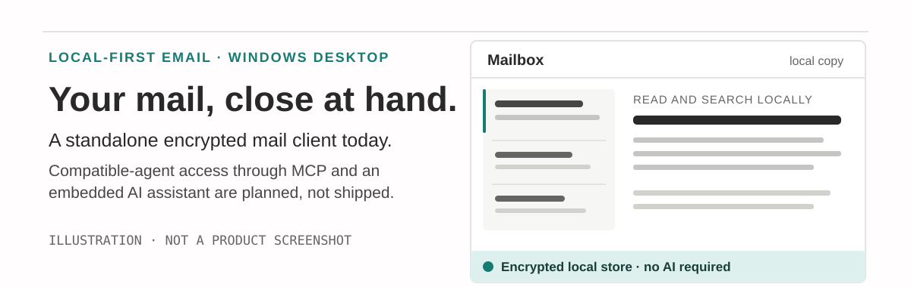
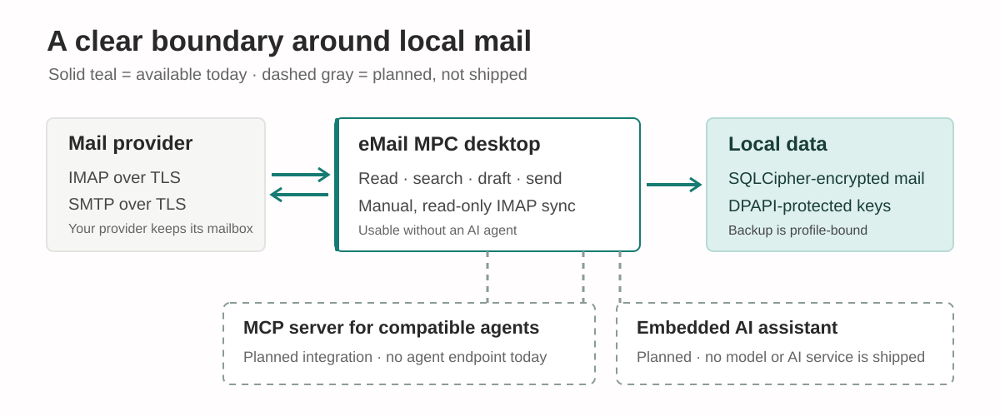

# eMail MPC

<p align="center">
  
</p>

**A Windows desktop email client with an encrypted local mail copy.** Use it on its own today. MCP access for compatible AI agents and an embedded AI assistant are part of the product direction, but are **not shipped yet**.

> **Status:** active development. eMail MPC is not a full mailbox migration tool or a replacement for keeping mail on your provider's server.

## What works today

- Connect compatible IMAP and SMTP accounts using provider-issued app passwords and certificate-validated TLS.
- Manually sync mail without changing server messages. Initial sync checks up to the 200 newest messages in each folder; later syncs are incremental.
- Read and search the local copy. Search supports eM Client-style operators, phrases, negation, OR groups, relevance ranking, and deterministic Romanian/English natural-language query interpretation.
- Save, reopen, edit, and delete plain-text drafts and their attachments in encrypted local storage. Drafts autosave after a short pause and when the compose window closes. Compose plain-text messages, attach files (up to 25 MiB total per message), and start reply, reply-all, and forward drafts from a selected message; sending is always an explicit SMTP action.
- Download selected attachments on demand, up to 25 MiB per file. Attachments are not opened automatically.
- Create and restore encrypted local backups. Restoring requires the Windows user profile that can decrypt the DPAPI-protected keys.
- Check for a release when you choose **Help → Check for updates**. The app verifies the published package's URL, size, and SHA-256 before offering to run the setup wizard. Portable builds stage a verified ZIP for manual replacement.

Local-first describes the app's copy and processing: your provider still hosts its mailbox, and IMAP/SMTP connections need internet access. Previously synced mail can be read and searched locally.

## AI agents and built-in AI

The goal is to keep the email client useful without an AI agent while making agent assistance an optional extension—not a requirement for using the mailbox.

| Use | Status |
| --- | --- |
| Standalone desktop email client | Available today; no AI agent is required |
| Compatible external agents through an MCP server | Planned; no MCP server or agent-facing email API is shipped |
| Built-in AI assistant | Planned; no model or assistant is shipped |

The natural-language search helper recognizes a limited set of Romanian and English phrases with local rules; it does not call an AI model or send the query to a cloud service.

MCP access and built-in AI are future product work, not current capabilities. Agents cannot currently read, search, or send mail through eMail MPC. The [roadmap](ROADMAP.md) remains the source of truth for planned work.

## How it works

<p align="center">
  
</p>

The desktop app stores message data in a SQLCipher-encrypted database. Windows DPAPI protects the database key and saved account credentials. IMAP folders are opened read-only; sending uses the account's configured SMTP server only when you choose to send.

## Get started

### Run from source

Requirements: Windows 10 or later and the .NET 10 SDK.

```powershell
git clone https://github.com/Hermeneuticus-of-things/e-Mail-MPC.git
cd e-Mail-MPC
dotnet test EMailMPC.slnx
dotnet run --project src/EMailMPC.Desktop/EMailMPC.Desktop.csproj
```

### Install a release

Open [Releases](https://github.com/Hermeneuticus-of-things/e-Mail-MPC/releases) and choose either the Windows x64 setup wizard or the portable ZIP. Release packages are self-contained. The setup wizard installs per user by default and supports an elevated machine-wide install.

Release artifacts include GitHub build-provenance attestations, which release CI verifies against this repository and the release workflow before publishing. To verify a downloaded asset with GitHub CLI, run `gh attestation verify <downloaded-file> -R Hermeneuticus-of-things/e-Mail-MPC --signer-workflow Hermeneuticus-of-things/e-Mail-MPC/.github/workflows/release.yml`. The desktop updater currently checks the manifest-pinned URL, size, and SHA-256; it does not yet verify attestations or an Authenticode publisher signature.

The installed app stores its data under `%LOCALAPPDATA%\eMail MPC\data`. Portable builds store a `data` folder beside the app. In both cases, the database key and saved account credentials are protected with Windows DPAPI and are tied to the Windows user profile; copying a profile to a different user or device is not a migration.

### First use

1. Choose **Add account**, enter the provider's IMAP/SMTP settings and an app password, then use **Verify and add**. Accounts requiring OAuth are not supported yet.
2. Choose **Sync mail** to download the newest messages. Sync is bounded and read-only on the server.
3. Search, read, and manage drafts locally. Choose **Compose** to send a plain-text message through SMTP; use **Attach files...** to include files within the 25 MiB combined limit.

Example searches:

```text
from:ana@example.com is:unread
subject:"project status" after:2026-01-01
de la ana necitite ieri
```

The Romanian/English query helper is deterministic and offline. Unrecognized phrases remain an ordinary literal search.

## Data protection and limits

- Messages, drafts, the search index, and attachment content are stored in the encrypted local database. Reply messages preserve `Message-ID`, `In-Reply-To`, and `References` headers for threading, including when a reply is saved as a draft. Successfully accepted outgoing messages are copied to a separate local Sent view; they are not yet reconciled with the provider's Sent folder.
- Account credentials and the database key are protected separately with Windows DPAPI.
- Backups are encrypted recovery archives, not portable transfer files. Restore them only with the Windows profile that can decrypt the protected keys. See [Local backup and restore](docs/LOCAL_DATA_BACKUP.md).
- Before a schema upgrade, the app keeps an encrypted pre-migration database snapshot. Use **File → Restore pre-migration snapshot...** to restore one; this rolls back mail data only, not the application version.
- Update checks are manual; the app does not poll in the background or send telemetry. SHA-256 checks detect package corruption but do not replace publisher code signing.
- The first sync and a UIDVALIDITY reset are limited to the newest 200 messages per folder. Full-history sync and mailbox migration are not available.
- Drafts autosave after a short pause and before the compose window closes; if saving fails, the window stays open so you can retry. After an uncertain SMTP failure, check the provider's Sent folder before retrying; the local Sent view only records messages confirmed accepted by SMTP.

Not implemented: OAuth, HTML composition, folder management, full-history synchronization, mailbox import/export, automatic update rollback, MCP access, embedded AI, and macOS/Android clients.

## Roadmap

The current work is completing the reliability foundation: user-triggered update verification and staging are implemented; automatic rollback, Windows installation/migration validation, and additional mailbox workflows remain. AI-agent access and an embedded assistant are future product work, not current capabilities.

See the full [roadmap](ROADMAP.md) for milestones, current progress, and exit criteria.

## Project documents

| Document | Purpose |
| --- | --- |
| [Roadmap](ROADMAP.md) | Milestones and remaining work |
| [Search specification](SEARCH_FEATURE_SPEC.md) | Local search syntax and behavior |
| [Backup and restore](docs/LOCAL_DATA_BACKUP.md) | Recovery archive contents and requirements |
| [Security policy](SECURITY.md) | Security boundaries and reporting |
| [Contributing](CONTRIBUTING.md) | Contribution guidance |

## Contributing and support

Bug reports and feature requests belong in the [issue tracker](https://github.com/Hermeneuticus-of-things/e-Mail-MPC/issues). Do not post security-sensitive findings publicly; follow [SECURITY.md](SECURITY.md) instead.

Contributions are welcome. Read [CONTRIBUTING.md](CONTRIBUTING.md) before making a substantial change.

## License

eMail MPC is distributed under the [MIT License](LICENSE).
